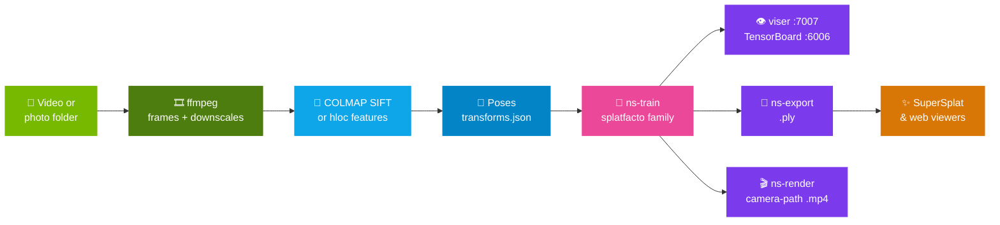
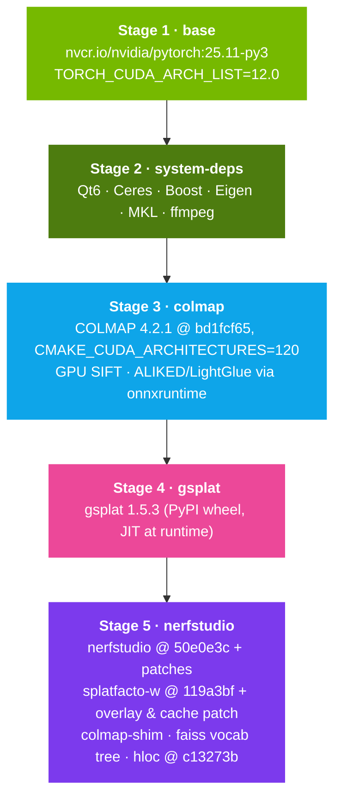

<p align="center">
  
</p>

<p align="center">
  <a href="#-quick-start"></a>
  <a href="#-features"></a>
  <a href="#-the-pipeline"></a>
  <a href="#-training-methods"></a>
  <a href="#-tech-stack"></a>
</p>

<p align="center">
  
  
  
  
  
  
  
  
  
</p>

<br/>

> A **fully reproducible Docker stack** that turns a video or a folder of photos into a **3D Gaussian Splat** on RTX 50-series GPUs. COLMAP and gsplat are compiled for `sm_120`, Nerfstudio is pinned to a known commit, every upstream patch is applied in the Dockerfile and asserted by a **92-check smoke test** that includes training every method — and a **PySide6 desktop app** drives the whole thing with a manifest-driven, lineage-tracked warehouse.

---

<br/>

## 🧠 What This Project Is

The official Nerfstudio image ships CUDA 11.8 and cannot run on a Blackwell GPU; the official COLMAP binary has no Blackwell kernels; gsplat JIT-compiles against whatever toolchain it finds. This repository fixes all of that in one multi-stage build on top of **NGC PyTorch 25.11** (CUDA 13.0, Python 3.12), then layers on the pieces you actually need day to day: five training methods, learned-feature matching, a 360° video path, viser and TensorBoard side by side, PLY export and camera-path rendering, and a desktop GUI whose every artifact traces back to its source video through `manifest.json` files alone.

Think of it as **the splat factory for one workstation** — build once, process, train, export, repeat — with every build-time decision written down and tested.

<br/>

## ✨ Features

<table>
<tr>
<td width="50%" valign="top">

**$\textsf{\color{#76B900}Reproducible Blackwell image}$**

&nbsp;&nbsp;🟢 COLMAP and gsplat compiled for **`sm_120`**; NGC PyTorch 25.11 base\
&nbsp;&nbsp;🟢 Every dependency **pinned to a commit or version** (`COLMAP_COMMIT`, `NERFSTUDIO_COMMIT`, `SPLATFACTOW_COMMIT`, `HLOC_COMMIT`, `VOCAB_TREE_SHA256` …)\
&nbsp;&nbsp;🟢 **Twelve upstream fixes** applied in the Dockerfile — flag renames, `torch.load` safety, viewer crash, submap promotion, splatfacto-w data loading, and more\
&nbsp;&nbsp;🟢 `smoke_test.sh` asserts **92 checks** against the running container — from CUDA kernels and patch anchors to a 300-iteration training run of every method on a synthetic dataset\
&nbsp;&nbsp;🟢 Warm rebuilds in **seconds** thanks to a 5-stage layout; `make fresh` for disaster recovery

</td>
<td width="50%" valign="top">

**$\textsf{\color{#0EA5E9}Processing (Structure from Motion)}$**

&nbsp;&nbsp;🔵 Video or image folders → frames → poses → `transforms.json`\
&nbsp;&nbsp;🔵 Camera types **perspective · fisheye · equirectangular · pinhole · simple_pinhole** (360° video is cut into perspective views automatically)\
&nbsp;&nbsp;🔵 Matching **sequential · vocab_tree · exhaustive** with a pre-placed faiss vocabulary tree\
&nbsp;&nbsp;🔵 **Learned features** via hloc — SuperPoint / DISK + LightGlue / SuperGlue — one dropdown away in the Process tab for scenes where SIFT struggles\
&nbsp;&nbsp;🔵 A PATH-shim promotes the **largest COLMAP submap** into `sparse/0` so a 2-frame bootstrap can never masquerade as the dataset\
&nbsp;&nbsp;🔵 iPhone **HEIC/HEIF → JPEG** conversion with EXIF preserved

</td>
</tr>
<tr>
<td valign="top">

**$\textsf{\color{#EC4899}Training}$ & $\textsf{\color{#EC4899}Export}$**

&nbsp;&nbsp;🌸 **Five methods**: `splatfacto`, `splatfacto-big`, `splatfacto-mcmc`, `splatfacto-w`, `splatfacto-w-light`\
&nbsp;&nbsp;🌸 **viser** 3D viewer (`:7007`) and **TensorBoard** (`:6006`) at the same time\
&nbsp;&nbsp;🌸 `splatfacto-w` works on **ordinary COLMAP datasets**, not just phototourism — dataparser v2 + colour-cache patch, verified end to end\
&nbsp;&nbsp;🌸 **Training resolution** chosen per run (Auto · Full · ½ · ¼ · ⅛), image-cache placement decided from the frame budget, and a 12 GiB first-eval VRAM spike removed at the source\
&nbsp;&nbsp;🌸 **PLY export** for every method, including a custom exporter that bakes splatfacto-w's appearance MLP into standard spherical harmonics\
&nbsp;&nbsp;🌸 **Training cameras for SuperSplat** — every export writes `<name>.cameras.json`: the exact (undistorted) cameras nerfstudio trained with, so SuperSplat draws them as frustums on the splat like viser does\
&nbsp;&nbsp;🌸 **Camera-path video** rendering from viser keyframes

</td>
<td valign="top">

**$\textsf{\color{#7C3AED}Desktop GUI}$ & $\textsf{\color{#7C3AED}Warehouse}$**

&nbsp;&nbsp;🟣 PySide6 app: **Dashboard · Process · Train · Exports · Viewers** — the exact `ns-*` commands, as forms with presets and tooltips\
&nbsp;&nbsp;🟣 **ULID-keyed warehouse** (`data_v2/`): source → process → train → export / render, each with a `manifest.json` that names its parent\
&nbsp;&nbsp;🟣 JSON-Schema-validated manifests, SHA-256 checksums, a **write-ahead `pending.json`** and a per-run `job.log`, so a closed GUI never strands a finished run and a failed one leaves evidence\
&nbsp;&nbsp;🟣 Import already-processed folders (nerfstudio or COLMAP layout) or runs processed live in **vizer**\
&nbsp;&nbsp;🟣 A narrow Docker allow-list: the app can `inspect`, `start` and `exec` — it can never build, remove or run containers

</td>
</tr>
</table>

<br/>

## 🎬 The Pipeline

One container, five CLIs, and a GUI that calls them for you. Every box below is a real command you can also run by hand.



### What goes in

| Input | How | Notes |
| :--- | :--- | :--- |
| **Video** (`.mp4`, `.MOV` …) | `ns-process-data video` — Process tab default | `--num-frames-target` samples frames evenly; sequential matching is the right default for continuous footage |
| **Photo folder** | `ns-process-data images` | JPEG, PNG, TIFF, CR2, HEIC/HEIF; exhaustive matching for < 100 photos |
| **360° video** | `--camera-type equirectangular` | Each frame becomes 8 (or 14) perspective crops; 376 / 376 crops registered on a 42-frame sample with COLMAP 4.2.1 (336 of 375 on 4.1.0.dev0) |
| **Already-processed folder** | GUI → *Import processed dataset* | `transforms.json` or `sparse/0` / `colmap/sparse/0` layouts, from `data/` or `data_v2/` |
| **Other pose sources** (CLI only) | `ns-process-data polycam · metashape · realitycapture · record3d · odm · aria` | Skip matching entirely; not exposed in the GUI |

### Camera & matching support, as measured

| Layer | Accepts | Notes |
| :--- | :--- | :--- |
| `ns-process-data --camera-type` | perspective, fisheye, equirectangular, pinhole, simple_pinhole | Maps to COLMAP `OPENCV`, `OPENCV_FISHEYE`, planar crops → `OPENCV`, `PINHOLE`, `SIMPLE_PINHOLE` |
| Importing a COLMAP model | + `SIMPLE_RADIAL`, `RADIAL`, `SIMPLE_RADIAL_FISHEYE`, `RADIAL_FISHEYE` | `FULL_OPENCV`, `FOV` and others raise `NotImplementedError` |
| What splatfacto trains on | perspective, fisheye, FISHEYE624 | All undistorted to pinhole before training; the rasterizer is always called as pinhole |
| `--matching-method` | `sequential`, `vocab_tree`, `exhaustive` | Under `--sfm-tool hloc`, `sequential` and `vocab_tree` both mean NetVLAD top-50 retrieval |
| hloc features / matchers that work here | `sift`, `superpoint_*`, `sosnet`, `disk` · `superglue*`, `NN-*`, `superpoint+lightglue`, `disk+lightglue` | `r2d2`, `d2net-ss`, `adalam` do not import in this build |

> [!NOTE]
> The SuperPoint / SuperGlue weights hloc ships are licensed by Magic Leap for **non-commercial research use only**. `disk+lightglue` is the permissively licensed combination.

<br/>

## 🧪 Training Methods

| Method | What it is | When to pick it |
| :--- | :--- | :--- |
| **`splatfacto`** | Nerfstudio's 3DGS recipe, default strategy | The starting point for most captures |
| **`splatfacto-big`** | Same, with lower cull / densify thresholds (`cull_alpha 0.005`, `densify_grad 0.0005`) | Detail-rich scenes; more gaussians, more VRAM |
| **`splatfacto-mcmc`** | MCMC densification (gsplat `MCMCStrategy`) with a fixed gaussian budget — 1 M by default, 2–4 M via the Train tab's **Max gaussians** control (`--pipeline.model.max-gs-num`) — relocation until step 25 k | Predictable gaussian budget; sparse-view scenes |
| **`splatfacto-w-light`** | In-the-wild variant: per-image appearance embedding, no background model | Exposure or lighting drift across the capture; runs on any processed dataset |
| **`splatfacto-w`** | Full in-the-wild model: appearance + learned background + transient masking | Crowded or changing scenes; needs the COLMAP sparse model with perspective cameras |

### Numbers from this machine (RTX 5070 Ti · `buddha_v2`, 261 frames, 4K source · 2026-10-05)

| Run | Gaussians | PSNR | Wall time |
| :--- | ---: | ---: | ---: |
| `splatfacto` 7 000 its @ 960 px | 329 059 | 30.99 | 87 s |
| `splatfacto` 30 000 its @ 960 px | 349 329 | 33.93 | 370 s |
| `splatfacto` 30 000 its @ 1920 px | 560 854 | 32.46 (viewed @ 1920) | 892 s |
| `splatfacto-big` 7 000 its @ 960 px | 688 515 | — | 123 s |
| `splatfacto-w-light` 7 000 its @ 960 px | 250 083 | 30.76 | 255 s |
| `splatfacto-w` 7 000 its @ 960 px | 253 578 | 29.43 (right-half protocol) | 205 s |

> [!TIP]
> A splat is only as sharp as the resolution it was trained at: the 960 px model scores **28.2 dB** when viewed at 1920 px, the 1920 px model **32.5 dB**. Nerfstudio's auto rule trains 4K sources at 960 px — see [`IMPROVEMENT_PLAN.md`](IMPROVEMENT_PLAN.md) §2.2 for the training-resolution control and the full measurements.

<br/>

## ⚡ Quick Start

### Prerequisites

| Requirement | Required | Notes |
| :--- | :---: | :--- |
| **Linux host** (tested on Pop!_OS 24.04) | ✅ | |
| **NVIDIA driver ≥ 580** + **NVIDIA Container Toolkit** | ✅ | `nvidia-smi` must work inside Docker |
| **Docker 28+** with Compose | ✅ | `docker compose version` |
| **Blackwell GPU** (RTX 5070 Ti, 5080, 5090 …) | ✅ | `TORCH_CUDA_ARCH_LIST=12.0` — see [Known limitations](#-known-limitations) for other cards |
| **`make`** | optional | Wraps the Compose commands below |

### 1. Clone and build

```bash
git clone https://github.com/AlexJumaW99/docker_splat_v2.git
cd docker_splat_v2
make fresh          # down → build → up → ./smoke_test.sh
```

Or without `make`:

```bash
docker compose build
docker compose up -d
./smoke_test.sh
```

A cold build takes **25–40 minutes** (COLMAP compiles from source); with a warm layer cache a rebuild takes seconds. The compose file carries the full runtime contract — GPU access, `--ipc=host`, 16 GB `/dev/shm`, the two bind mounts (`data/` → `/workspace`, `data_v2/` → `/warehouse`), the two ports, and four cache volumes that survive rebuilds.

### 2. Process → train → view (CLI)

```bash
docker compose exec nerfstudio bash           # a shell at /workspace

ns-process-data video --data /workspace/yourvideo.mp4 \
  --output-dir /workspace/processed/yourvideo_splat \
  --num-frames-target 250 --matching-method sequential

ns-train splatfacto --data /workspace/processed/yourvideo_splat \
  --output-dir /workspace/outputs --max-num-iterations 30000 \
  --vis viewer+tensorboard \
  --viewer.websocket-host 0.0.0.0 --viewer.quit-on-train-completion False
```

Open **http://localhost:7007** for the live 3D view. In a second shell run `tensorboard --logdir /workspace/outputs --bind_all --port 6006` and open **http://localhost:6006**.

### 3. Or use the desktop GUI

```bash
cd gui && ./run.sh
```

First launch creates `.venv/` and installs PySide6 6.11, pydantic and pillow-heif. Everything the GUI writes lands in the `data_v2/` warehouse with lineage manifests. See [`gui/README.md`](gui/README.md).

> [!IMPORTANT]
> The full walkthrough — recording tips, every flag, the warehouse layout, exporting to SuperSplat, troubleshooting — is in **[USER_GUIDE.md](USER_GUIDE.md)**.

<br/>

## 🏗️ Build Architecture



Each stage is buildable on its own with `docker build --target <stage>`. The upgrade ritual for any pinned component is: bump the `ARG`, rebuild, run `./smoke_test.sh`.

<details>
<summary><b>🔧 What's been fixed — thirteen issues you would otherwise hit</b></summary>
<br/>

| Issue | Root cause | Fix |
|---|---|---|
| COLMAP CMake fails with `Could NOT find Qt6Svg` | Undocumented new Qt6 Svg dependency in COLMAP 4.1.0.dev0 | `qt6-svg-dev` added to `apt install` list |
| Nerfstudio `ns-process-data video` fails with `unrecognised option '--SiftExtraction.use_gpu'` | COLMAP renamed SIFT-specific GPU flags to generic `FeatureExtraction.use_gpu` when ALIKED support was added | `sed` patch applied to nerfstudio's `colmap_utils.py` in Stage 5 |
| `PYTORCH_CUDA_ALLOC_CONF` warning on every invocation | Env var renamed to `PYTORCH_ALLOC_CONF` in PyTorch 2.10 | Compose sets the new name. Measured 2026-10-05: in the NGC 25.11 build the new name alone does **not** enable expandable segments; setting both does — tracked as [`IMPROVEMENT_PLAN.md`](IMPROVEMENT_PLAN.md) §2.6 |
| `ns-train` fails to resume from checkpoints with `_pickle.UnpicklingError: Weights only load failed` | PyTorch 2.6 flipped `torch.load`'s `weights_only` default to `True`; nerfstudio's checkpoints include non-tensor state and fail the new safety check | `sed` patch in Stage 5 pins `weights_only=False` in nerfstudio's loader |
| `ns-export gaussian-splat` crashes with `AssertionError` on splatfacto-w runs | Upstream exporter hard-asserts `isinstance(pipeline.model, SplatfactoModel)`, but `SplatfactoWModel` inherits from `Model` directly — and splatfacto-w computes SH coefficients per-frame from an appearance MLP rather than storing them as tensors | Image ships a custom `ns-export-splatfactow` CLI that bakes one appearance embedding (average of training cameras by default) into per-gaussian SH coefficients and writes an inria-format `.ply` with the same layout as `ns-export gaussian-splat`. The GUI Exports tab auto-routes to it for splatfacto-w/-light. |
| `ns-process-data` silently exports a 2-frame `transforms.json` on longer videos | COLMAP's `incremental_pipeline` (4.1.0.dev0, still 4.2.1) seeds a 2-image bootstrap as `sparse/0` before growing the main reconstruction into `sparse/1`. Nerfstudio's converter hardcodes `colmap_model_path = Path("colmap/sparse/0")`, so it reads the bootstrap stub and the real 200+-frame model sits unused on disk. | Image ships a PATH-shim (`/opt/colmap-shim/colmap`) that transparently wraps `colmap mapper`. After a successful mapper run it probes every numeric submap with `model_analyzer`, name-swaps the largest into `sparse/0`, and preserves the original `sparse/0` under its old name for inspection. Also injects `--Mapper.snapshot_path` so viser can watch incremental progress. Non-mapper subcommands pass through untouched. |
| Two builds done a month apart could ship different COLMAP code under the same `4.1.0.dev0` version string | `git clone --depth 1` always pulled whatever was at `main` HEAD; nothing pinned the actual commit | `ARG COLMAP_COMMIT` in Stage 3 pins to a specific upstream SHA (currently `bd1fcf65`, the 4.2.1 release tag); partial clone (`--filter=blob:none`) checks out exactly that commit. Resolved SHA is recorded at `/etc/colmap-commit.sha` in the image, and `smoke_test.sh` asserts it matches the Dockerfile pin. |
| `splatfacto-w` training crashes with `FileNotFoundError: dense/sparse/cameras.bin` on non-phototourism datasets | Upstream `nerfw_dataparser.py` hardcodes phototourism-specific paths (`dense/sparse/`, `dense/images/`), asserts only `PINHOLE` cameras, iterates camera models instead of images, and requires a TSV train/test split file that only phototourism ships | `COPY` overlay replaces `nerfw_dataparser.py` in Stage 5: uses `config.colmap_path`, auto-detects `dense/images/` or `images/`, iterates images, and falls back to a deterministic fraction-based eval split when no TSV file is present. The GUI's Train tab emits the `splatfactow_dataparser --colmap-path <rel>` tyro subcommand. |
| `splatfacto-w` training crashes with `IndexError` on gsplat 1.5.3 (`mask shape [200206] is not broadcastable to [100103, 2]`) | gsplat 1.5.3 changed `info["radii"]` from shape `[C, N]` to `[C, N, 2]` (per-axis radii). `splatfactow_model.py` sliced `info["radii"][0]` expecting `[N]` | `sed` patch in Stage 5 collapses the per-axis radii with `.amax(dim=-1)` |
| `splatfacto-w-light` fails at load with `AssertionError: The size of image (3840, 2160) loaded does not match the camera parameters ((3838, 2161))`; `splatfacto-w` floods `Image shape … does not match camera shape`, then dies with `CUDA out of memory` on 4K data. SIMPLE_PINHOLE datasets fail with `Only {'PINHOLE', 'OPENCV'} camera models are supported` | The v4.4 NerfW overlay built `Cameras` without width/height, so nerfstudio derived them as `int(2·cx) × int(2·cy)` — wrong once COLMAP's bundle adjuster has refined the principal point (13 of 14 OPENCV datasets in the warehouse). It also dropped the OPENCV distortion coefficients, accepted only PINHOLE/OPENCV and always read full-resolution `images/`. splatfacto-w's datamanager skips mismatched frames recursively, moving one 4K frame to the GPU per recursion, so the real error surfaced as an OOM. The GUI also routed `splatfacto-w-light` through this parser although its upstream default is `nerfstudio-data`. | v4.7 overlay reads intrinsics through nerfstudio's own `parse_colmap_camera_params` (real size, distortion, perspective-family models), rejects fisheye explicitly, and picks `images_<N>` with nerfstudio-data's ≤ 1600 px rule. The Train tab routes only `splatfacto-w` through `splatfactow_dataparser` and refuses to start it on a project without a COLMAP sparse model; `splatfacto-w-light` uses the standard dataparsers again. |
| `splatfacto-w` training dies at a random step with `AssertionError: torch.Size([112061, 16, 3])` from `gsplat/rendering.py` | Upstream `splatfactow_model.py` reuses `cached_colors` in eval whenever the eval camera index equals the last *training* camera index, without checking the gaussian count; densify/cull and in-training eval both run every 100 steps, so the cache is one densification stale whenever the indices coincide ([upstream issue #14](https://github.com/KevinXu02/splatfacto-w/issues/14), open since 2024-08) | `patch`-applied 3-line change in Stage 5: only eval renders populate `cached_colors` / `cached_bg_sh`, and a cached tensor must match the live gaussian count. Applied with `patch --forward --batch` so the build fails if upstream drifts. |
| `ns-process-data … --sfm-tool hloc` says `you must install hloc toolbox!!` after a rebuild | hloc, LightGlue, kornia and pycolmap had been installed by hand into the running container's writable layer only; `docker compose up --build` recreated the container without them | Stage 5 bakes hloc (`HLOC_COMMIT`), LightGlue (`LIGHTGLUE_COMMIT`), `pycolmap==3.13.0` and `kornia==0.8.3` into the image; `smoke_test.sh` §18 asserts the imports. |
| Every training run's VRAM peak was the **first eval image**, far above anything training itself needed: +3.15 GiB at 960 px, +12.4 GiB at 1920 px, enough to OOM a 1920 px run on a 16 GB card whose training steps use 1.8 GiB | `nerfstudio/scripts/train.py` sets `torch.backends.cudnn.benchmark = True`; the first LPIPS evaluation (torchmetrics AlexNet convolutions at full eval resolution) then makes cuDNN benchmark every convolution algorithm, workspaces included. The second call costs 0.5 GiB. Eval cadence only moves the spike. | v4.8 `sed` patch makes autotuning opt-in (`NS_CUDNN_BENCHMARK=1`). Measured: peak 11.15 → 2.42 GiB at 1920 px, 3.72 → 0.90 GiB at 960 px, identical wall time and 4.0 ms train-iteration time. `smoke_test.sh` §20 asserts the anchor and the effective value. |

</details>

<br/>

## ✅ Verification Status

All of the following were re-verified on 2026-10-05 / 06 against images `4bc97967` (v4.7), `55c12378` (v4.8) and `4682ac79` (v4.9, COLMAP 4.2.1).

| Check | Result |
| :--- | :--- |
| Image build + `smoke_test.sh` | ✅ **94 / 94** (2026-10-11) — GPU passthrough, sm_120 kernels, cuDNN, COLMAP flags + commit pin, gsplat JIT rasterization, every Stage-5 patch anchor, hloc imports, expandable allocator segments, cuDNN autotuning off, and §21: all five methods train 300 iterations on a synthetic dataset, both exporters write a PLY, the splatfacto-w cache check passes, and both exports get a training-cameras file whose 8 cameras all aim at the scene centre (worst 0.009°) |
| Train-tab Tier 2 controls | ✅ GUI-generated commands ran end to end: `--downscale-factor 2` via `nerfstudio-data`, `colmap` and `splatfactow_dataparser`; `camera-res-scale-factor 0.5` on a dataset without `images_2`; auto CPU cache at native 4K; `antialiased`; *Add downscale levels* (16 frames → images_2/4/8 in 6 s). 1920 px run peak 11.15 → 2.42 GiB after v4.8 |
| `ns-process-data` sequential / vocab_tree / exhaustive | ✅ 87 / 87 frames registered on an 87-frame set with both COLMAP builds — 4.2.1: 16 / 28 / 21 s, 4.1.0.dev0: 23 / 33 / 35 s, same day, models within 2 % in point count; on a 61-frame set vocab_tree matched the same 1 830 pairs as exhaustive with the faiss tree |
| `ns-process-data --camera-type equirectangular` | ✅ 42-frame sample → 376 perspective crops; COLMAP 4.2.1 registered 376 / 376 in 282 s (4.1.0.dev0: 336 of 375 in 321 s) |
| `ns-process-data --sfm-tool hloc` (SuperPoint + LightGlue) | ✅ 87 / 87 frames registered from the image-baked toolbox |
| `splatfacto` · `splatfacto-big` · `splatfacto-mcmc` | ✅ 3 500-iteration runs: 232 059 / 449 436 / 541 117 gaussians, PLY export + `ns-eval` clean |
| `splatfacto-w-light` | ✅ 7 000 iterations with `nerfstudio-data` and 2 000 with `colmap`; export, `ns-viewer`, `ns-render` pass |
| `splatfacto-w` | ✅ 7 000 iterations on an off-centre OPENCV dataset and on a SIMPLE_PINHOLE dataset; export, viewer, 480-frame 4K render pass; 12-image stress run completes where the unpatched model died at step 1 590 |
| viser + TensorBoard simultaneously | ✅ Both bridged to the host; minor viewer stutter during eval steps |
| COLMAP multi-submap promotion shim | ✅ Largest submap swapped into `sparse/0` on splintered runs — still needed on 4.2.1 (3-image bootstrap seeded as `sparse/0` on the equirect run, 376-image model promoted from `sparse/1`) |

<br/>

## ⚠️ Known Limitations

> [!WARNING]
> **Blackwell only by design.** `TORCH_CUDA_ARCH_LIST=12.0` targets `sm_120` exclusively. For an Ada or Ampere card change it to `8.9` or `8.6` in the Dockerfile and rebuild.

> [!WARNING]
> **16 GB of VRAM is the assumption.** Training at native 4K can OOM on a 5070 Ti: `splatfacto-big` on 266 4K frames peaked at 11.6 GiB by step 6 500 with the default GPU image cache. The Train tab's **Training resolution** and **Image cache** controls are the levers (numbers in [`IMPROVEMENT_PLAN.md`](IMPROVEMENT_PLAN.md) §2). Since v4.8 the image also disables cuDNN autotuning in `ns-train`, which removed a 12.4 GiB first-eval spike at 1920 px at no speed cost, and `docker-compose.yml` sets both allocator variables because `PYTORCH_ALLOC_CONF` alone does **not** enable expandable segments in the NGC 25.11 torch build.

- **Container runs as root.** Files written under `data/outputs/` and inside `data_v2/trained/<ULID>/` are `root:root` on the host; `sudo chown -R $USER:$USER` them when needed.
- **`ns-download-data` is broken upstream** (Google Drive rate limits, [nerfstudio#3134](https://github.com/nerfstudio-project/nerfstudio/issues/3134)). Use your own footage.
- **Not verified here:** fisheye captures end to end (no fisheye footage on this machine), the original phototourism layout with the v2 dataparser, and the compatibility of `antialiased`-mode PLYs with external viewers.

<br/>

## 📂 Project Structure

```
docker_splat_v2/
├── Dockerfile                    # 🐳 5-stage build; every pin and patch is an ARG or a commented RUN
├── docker-compose.yml            # 🧩 The runtime contract: GPU, ipc, shm, mounts, ports, cache volumes
├── Makefile                      # ⚡ build · up · shell · test · fresh · heal-net
├── smoke_test.sh                 # ✅ 92 checks against the running container (21 sections, incl. training every method)
├── image_bin/
│   ├── colmap-shim               # 🔀 Promotes the largest COLMAP submap into sparse/0; snapshots for viser
│   ├── nerfw_dataparser.py       # 🧭 splatfacto-w dataparser v2 (real sizes, distortion, images_<N>)
│   ├── splatfactow_model_cache.patch   # 🩹 3-line eval colour-cache guard, applied with `patch`
│   └── ns-export-splatfactow     # 💾 PLY exporter that bakes splatfacto-w's appearance MLP into SH
├── gui/                          # 🖥️ PySide6 desktop app (see gui/README.md)
│   ├── run.sh                    #    creates .venv and launches
│   ├── app/                      #    views/, warehouse.py, manifest.py (+ JSON Schema), train_options.py, jobs.py …
│   └── tests/                    #    unit tests for the Qt-free training-option logic
├── scan_catalog.py               # 🗂️ Rebuilds catalog.db over the legacy data/ tree
├── IMPROVEMENT_PLAN.md           # 🗺️ Measured backlog: Tier 1 (done) · Tier 2 · Tier 3
├── USER_GUIDE.md                 # 📚 Full walkthrough, flags, troubleshooting
├── data/                         # 🎞️ Legacy artifact tree (git-ignored)   → /workspace in the container
└── data_v2/                      # 🏭 ULID warehouse with manifests (git-ignored) → /warehouse
```

<br/>

## 🗺️ Roadmap

The measured backlog lives in [`IMPROVEMENT_PLAN.md`](IMPROVEMENT_PLAN.md): **Tier 1** (splatfacto-w data loading, colour-cache crash, hloc in the image — landed in v4.7), **Tier 2** (training-resolution control, in-training eval cadence, CPU image cache, pose-recovery gate, persisted job logs, allocator env — landed 2026-10-05), **Tier 3** (30k default with quick picks, per-method training smoke, Feature-engine control, typed manifest fields, GPU-release card, warehouse repair command — landed 2026-10-06; the COLMAP 4.2.1 trial passed side-by-side validation and shipped as image v4.9).

<br/>

## 🧩 Tech Stack

<table>
<tr>
<td align="center" width="20%"><br/><br/><sub><b>Base image</b></sub><br/><br/></td>
<td align="center" width="20%"><br/><br/><sub><b>Structure from Motion</b></sub><br/><br/></td>
<td align="center" width="20%"><br/><br/><sub><b>Learned features</b></sub><br/><br/></td>
<td align="center" width="20%"><br/><br/><sub><b>Rasterizer</b></sub><br/><br/></td>
<td align="center" width="20%"><br/><br/><sub><b>Training CLI</b></sub><br/><br/></td>
</tr>
<tr>
<td align="center"><br/><br/><sub><b>In-the-wild methods</b></sub><br/><br/></td>
<td align="center"><br/><br/><sub><b>3D viewer</b></sub><br/><br/></td>
<td align="center"><br/><br/><sub><b>Metrics</b></sub><br/><br/></td>
<td align="center"><br/><br/><sub><b>Desktop GUI</b></sub><br/><br/></td>
<td align="center"><br/><br/><sub><b>Runtime</b></sub><br/><br/></td>
</tr>
</table>

<br/>

<details>
<summary><b>📜 Project history</b></summary>
<br/>

`v3-working` (commit `349e43e`) is the tagged milestone — the first Dockerfile that produced a working pipeline from scratch. Image versions since then (`v4.x`) are annotated in the Dockerfile comments.

```
Tier 3 + v4.9: 30k default, Feature engine, typed SfM manifest fields, GPU-release card, training smoke, COLMAP 4.2.1
Tier 2 + v4.8: training-resolution control, VRAM fixes, pose-recovery gate, job logs
v4.7: fix splatfacto-w / -w-light on standard datasets, bake hloc into the image
New Project import: adopt warehouse runs processed in vizer
Manifest schema: accept pinhole / simple_pinhole camera types
Process tab: add 'Run with vizer' live-viewing handoff
Harden warehouse: schema validation, manifest index, full project deletion
Fix splatfacto-w training on non-phototourism datasets
Migrate GUI Exports tab to manifest-driven ULID warehouse
Migrate GUI Process + Train tabs to manifest-driven ULID warehouse
Upgrade gsplat 1.4.0 -> 1.5.3
Add scan_catalog.py: rebuild catalog.db index over data/ tree
Add vizer live point-cloud viewer button to Process tab + project management enhancements
Add HEIC/HEIF auto-conversion to JPEG in the Process tab GUI
Add Viewers tab with ns-viewer launch, TensorBoard start/stop, and live port status
Document network-detachment recovery + add make heal-net
Add image-folder source mode to the Process tab GUI
Pin COLMAP commit + smoke-test SHA against Dockerfile pin
Add Makefile wrapping compose + smoke-test for disaster-recovery shortcuts
Fix viewer split-mode crash by filtering gl_z_buf_depth from dropdowns
Relocate repo from ~/Desktop to ~/docker-stacks; pin PySide6==6.11.0
Capture runtime contract in docker-compose.yml + trim build context
Auto-promote largest COLMAP submap into sparse/0 via PATH-shim
Warn on Process tab when COLMAP splinters into multiple submaps
Pre-place faiss-format vocab tree for vocab_tree matcher
Add help-badge tooltips across GUI and retheme to light palette
Add advanced controls to Process tab and drop broken depth-debug flag
Add splatfacto-w .ply exporter and route GUI Exports tab to it
Bake splatfacto-w into image and expose in Train dropdown
Add Exports tab with .ply export and camera-path video render
Fork naming to v2 and pin nerfstudio to git main (enables splatfacto-mcmc)
Add "import processed dataset" flow to skip straight to training
Add Train tab and viser-port safety helpers
Add smoke_test.sh for container verification
v3.2 — patch nerfstudio torch.load for PyTorch 2.6+ weights_only default
v3.1 — add TensorBoard monitoring (EXPOSE 6006) + docs
v3   — patch nerfstudio for COLMAP SiftExtraction→FeatureExtraction flag rename
v2   — multi-stage refactor + add qt6-svg-dev to fix COLMAP build
v1   — single-stage build, fails at COLMAP/Qt6Svg (baseline)
```

</details>

<br/>

## 🙏 Acknowledgements

Built on [**Nerfstudio**](https://github.com/nerfstudio-project/nerfstudio) and [**gsplat**](https://github.com/nerfstudio-project/gsplat) (the training framework and the CUDA rasterizer), [**COLMAP**](https://github.com/colmap/colmap) (Structure from Motion), [**splatfacto-w**](https://github.com/KevinXu02/splatfacto-w) by KevinXu02 (in-the-wild variants), [**hloc**](https://github.com/cvg/Hierarchical-Localization) and [**LightGlue**](https://github.com/cvg/LightGlue) from ETH Zurich's CVG, [**viser**](https://github.com/nerfstudio-project/viser), [**TensorBoard**](https://www.tensorflow.org/tensorboard), and NVIDIA's [**NGC PyTorch**](https://catalog.ngc.nvidia.com/orgs/nvidia/containers/pytorch) base image. The faiss-format vocabulary tree comes from [ZachMckennedyFWig/ColmapFaissVocabTrees](https://github.com/ZachMckennedyFWig/ColmapFaissVocabTrees).

<br/>

<p align="center">
  
</p>

<p align="center">
  <sub>Crafted by Alex Juma — capture, reconstruct, splat 🎥✨</sub>
</p>
