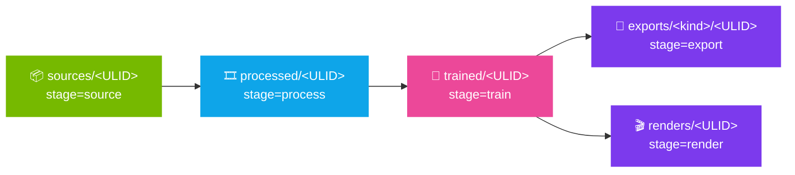

<p align="center">
  
</p>

<p align="center">
  <a href="#-run-it"></a>
  <a href="#-the-tabs"></a>
  <a href="#-projects"></a>
  <a href="#-lineage--manifests"></a>
  <a href="#-safety-guarantees"></a>
</p>

<p align="center">
  
  
  
  
  
</p>

<br/>

> A **thin, read-mostly front end over `docker exec`**. Every button runs the same `ns-process-data` / `ns-train` / `ns-export` / `ns-render` / `ns-viewer` command you would type by hand — shown to you verbatim — wrapped in forms with sensible defaults, per-project presets, and a **manifest-driven warehouse** in which every artifact names the run it came from.

---

<br/>

## ⚡ Run It

```bash
cd gui && ./run.sh
```

First launch creates `.venv/` and installs **PySide6 6.11.0**, **pydantic ≥ 2.5** and **pillow-heif ≥ 1.3** (about 90 MB). Later launches are instant. The app expects the `splat-ns-v2` container from the repository root's `docker compose up -d`; if it is missing, the Dashboard shows the build and create commands with copy buttons and never runs them for you.

<br/>

## 🗂️ The Tabs

| Tab | State | What it does |
| :--- | :---: | :--- |
| **Dashboard** | live | Polls the Docker daemon, the `splat-ns-v2` container and the GPU (`nvidia-smi`). Can start a stopped container, and can start a stopped Docker daemon through a `pkexec systemctl start docker` prompt. Shows copyable `docker build` / `docker create` commands when the container is missing. |
| **Process** | live | Form-driven `ns-process-data` for a **video** or an **image folder**. Frames target, matching method, **Feature engine** (COLMAP · SIFT or hloc · SuperPoint/DISK + LightGlue/SuperGlue, recorded as typed `sfm_tool` / `feature_type` / `matcher_type` manifest fields), downscale levels, camera type, crops, intrinsics refinement, seeds, SfM depth, eval video, raw CLI flags. Live `ffprobe` readout for videos; image count for folders; automatic **HEIC/HEIF → JPEG** (quality 100, EXIF kept, originals in `heic_originals/`). Optional **Run with vizer** hands the identical command to the vizer container so you can watch the point cloud form live. After a run: a **Poses recovered N of M** pill (green ≥ 90 %, amber, red below 50 % with a what-to-try panel), a splinter warning when COLMAP produced several submaps, and `job.log` in the dataset folder. |
| **Train** | live | Form-driven `ns-train`. Method picker (`splatfacto`, `splatfacto-big`, `splatfacto-mcmc`, `splatfacto-w`, `splatfacto-w-light`), **Training resolution** built from the dataset's `images_N` copies (Auto · Full · ½ · ¼ · ⅛, with an *Add downscale levels* action when the folders are missing), iteration slider (default 30 000, up to 60 000, with *Preview 7k · Standard 30k · Long 55k* quick picks and the method's upstream default named), checkpoint cadence, viser + TensorBoard mode, quit-on-completion. After the completion banner the viser card shows the GPU memory the idle viewer still holds and offers **Release GPU**; Run warns when under 3 GiB of VRAM is free. Advanced: **Image cache** Auto / GPU / CPU with a live size estimate, **Eval cadence** (default every 1000 steps), **Rasterize mode**, raw CLI flags. The DATASET card shows how many frames received a pose and the tab asks for confirmation below 50 %. Picks the right dataparser subcommand for the project (`nerfstudio-data`, `colmap --colmap-path …`, or `splatfactow_dataparser` for `splatfacto-w` only), refuses `splatfacto-w` without a COLMAP sparse model, and writes every output line to `job.log` beside the run's manifest. Detects when viser comes up and deep-links to `http://localhost:7007`. |
| **Exports** | live | `ns-export gaussian-splat` (PLY) — auto-routed to the image's `ns-export-splatfactow` for the w-methods — and `ns-render camera-path` (MP4 from a viser keyframe JSON). Each artifact gets its own ULID directory and manifest. `mesh/` and `pointcloud/` are reserved by the layout but not wired: those exporters need the volumetric-NeRF model interface that `SplatfactoModel` does not implement. |
| **Viewers** | live | Live port-status cards for viser (`:7007`) and TensorBoard (`:6006`). Run picker scoped to the active project — launch `ns-viewer` on a finished checkpoint, start / stop TensorBoard, open either in the browser. |
| **Runs** | stub | Placeholder for a training-run browser. |

> [!TIP]
> Every form field has a **?** help badge explaining the flag it drives and sensible ranges. **Advanced mode** reveals the raw-flag box; anything typed there is appended verbatim to the command.

<br/>

## 📁 Projects

A project bundles one dataset with its processing and training runs. **+ New project** offers three routes:

| Route | Point it at | Then |
| :--- | :--- | :--- |
| **From video** | A video file inside `~/docker-stacks/docker_splat_v2/data/` | Process → Train |
| **From images** | A folder of photos inside `data/` (conventionally `data/input_images/<scene>/`); JPEG, PNG, TIFF, CR2, HEIC/HEIF | Process → Train |
| **Import processed dataset** | An already-processed folder inside `data_v2/` or `data/` — including runs processed in **vizer** | Straight to Train |

Import auto-detects the layout: `transforms.json` at the root → `nerfstudio-data`; `sparse/0/cameras.bin` or `colmap/sparse/0/cameras.bin` → `colmap`, with the relative path stored on the project so `ns-train` receives `--colmap-path <rel>`.

Per-project state — presets, last-used parameters, dataparser metadata — persists in `~/.config/docker_splat_v2_gui/projects.json`. Delete the directory to reset; it is recreated on the next launch.

<br/>

## 🧬 Lineage & Manifests

Process, Train, Export and Render runs all write into the ULID-keyed warehouse at `~/docker-stacks/docker_splat_v2/data_v2/` (mounted in the container at `/warehouse/`). Each run carries a `manifest.json` that declares its parent, so a `.ply` or an `.mp4` traces back to its source video through four file reads and nothing else:



The schema (Pydantic v2 + JSON Schema Draft 2020-12, frozen at v1.0) lives in [`app/manifest.py`](app/manifest.py) with the generated artifact at [`app/manifest_schema.json`](app/manifest_schema.json). The side-effect layer that mints ULIDs, computes SHA-256 checksums, copies sources, scrapes metrics and writes manifests is [`app/warehouse.py`](app/warehouse.py); [`app/manifest_index.py`](app/manifest_index.py) validates and indexes what is on disk.

### Why training also writes a `pending.json`

`ns-train` usually runs with `--viewer.quit-on-train-completion False`, so the process stays alive long after the last iteration to keep viser up. A manifest written "on process exit" would therefore never fire until you close the viewer — and if the GUI died in that window the finished run would be an orphan with no lineage. The Train tab solves both:

1. **Write-ahead sidecar.** Before `ns-train` starts, `data_v2/trained/<ULID>/pending.json` records the parent run, the command, the form parameters and the start time.
2. **Banner detection.** The tab watches stdout for nerfstudio's `🎉 Training Finished 🎉` banner and finalizes the `TrainManifest` the moment it appears, independent of process exit. The sidecar is then removed, preserving the invariant *manifest present = success*.
3. **Exit fallback.** If the banner is never seen but the process exits 0, the manifest is written from the exit path.

### Warehouse command line

```bash
./.venv/bin/python -m app.warehouse backfill-train ../data_v2/trained/<ULID>   # rebuild a manifest for an orphan run (provenance="backfilled")
./.venv/bin/python -m app.warehouse refresh-process ../data_v2/processed/<ULID> # re-scrape outputs/metrics/checksums of a process manifest written too early (keeps a .bak)
./.venv/bin/python -m app.warehouse verify <manifest.json> [...]               # re-check recorded SHA-256 checksums
./.venv/bin/python -m app.warehouse stale-pending                               # train runs with pending.json but no manifest (> 24 h old)
./.venv/bin/python -m app.warehouse orphans                                     # manifests whose parent.run_id does not resolve
```

`backfill-train` works from `config.yml` alone if the sidecar is gone and refuses to overwrite an existing manifest.

<br/>

## 🔒 Safety Guarantees

The Docker wrapper in [`app/docker_service.py`](app/docker_service.py) exposes a deliberately narrow allow-list:

| Allowed | Used for |
| :--- | :--- |
| `docker version`, `docker info`, `docker inspect`, `docker image inspect`, `docker port` | Read-only status on the Dashboard and Viewers tabs |
| `docker start` | Starting a stopped `splat-ns-v2` |
| `docker exec` | Streaming `ns-*` jobs through `JobManager`; an in-container port probe; a `pkill`-based reclaim of a stuck viser port; detached TensorBoard start / stop |
| `pkexec systemctl start docker` | Starting a stopped Docker *daemon* after the system's own authorization prompt |

It **cannot** build, create, remove, commit, tag, push, rename, stop, kill or run containers — those subcommands have no method to call. Your image and container are safe from the GUI by construction.

<br/>

## ⚙️ Config

State lives in `~/.config/docker_splat_v2_gui/`:

- `projects.json` — project list, active project, presets, last-used parameters.

Delete the directory to reset. The app recreates it on the next launch.

<br/>

<p align="center">
  
</p>
